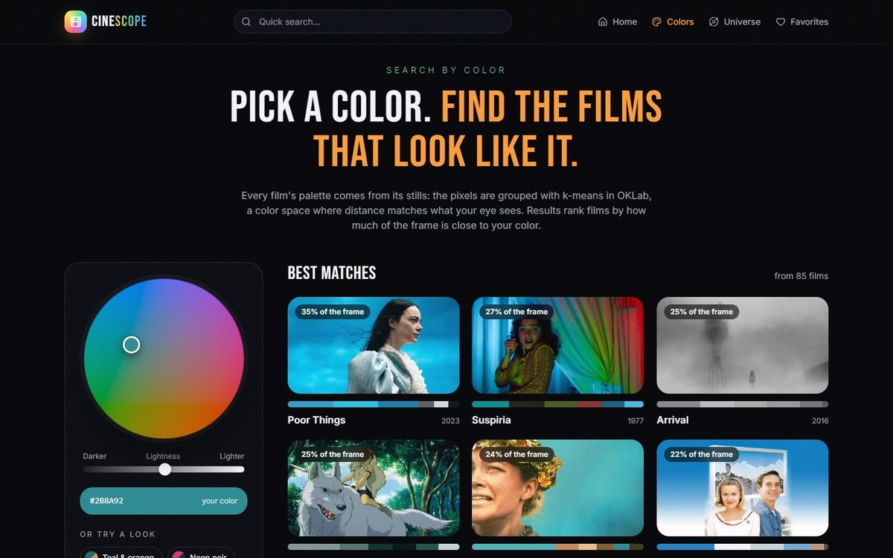
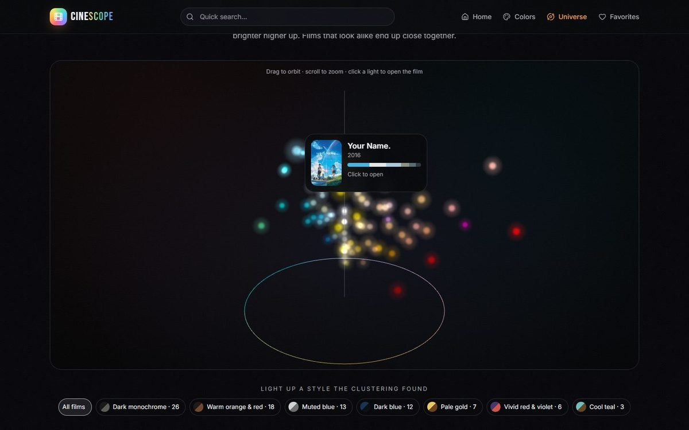
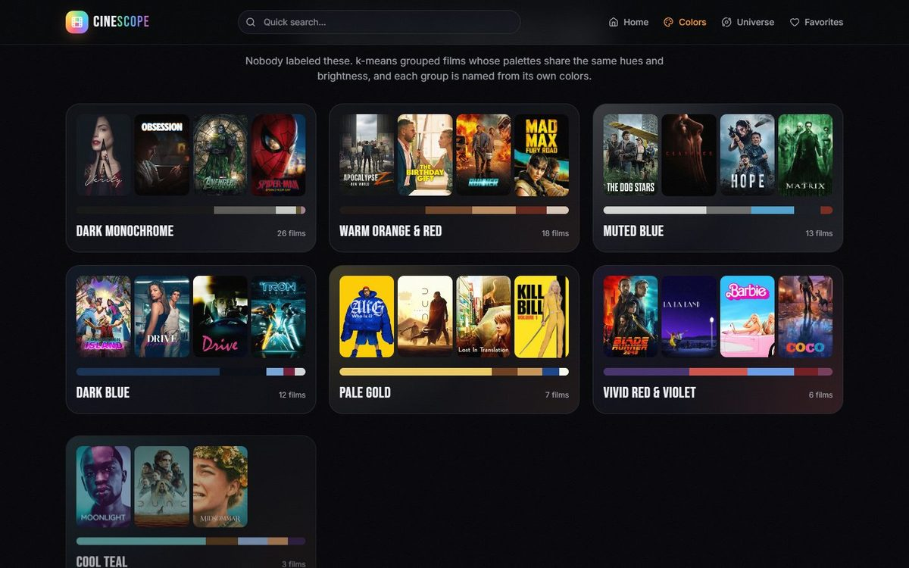
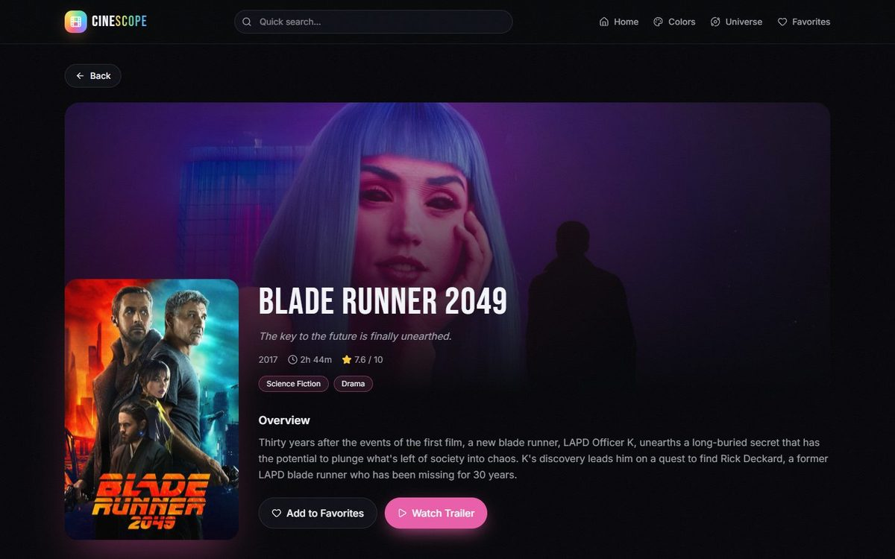

# CineScope

[](https://github.com/ramezGamel01/CINESCOPE/actions/workflows/ci.yml)

Find films by their colors. Pick a color, drop in a photo, or fly through a 3D universe of films, and CineScope finds the movies that look like it. It also works as a regular movie app: trending films, search, cast, trailers and favorites.

**Live:** https://cinescope-gamma-ruby.vercel.app


## What makes it different

- **Search by color.** A perceptual color wheel and preset looks (teal & orange, neon noir, desert gold...). Films are ranked by how much of their frame is close to your color.
- **Match a photo.** Drop any image; its palette is extracted in your browser (nothing is uploaded) and matched against every film.
- **The color universe.** Every film as a point of light in 3D color space (three.js): hue around the ring, colorfulness outward, brightness upward. Orbit, zoom, hover, click to open.
- **Visual styles found by clustering.** k-means groups films whose palettes share the same hues and brightness, and each group is named from its own colors.
- **Movie pages tinted by the film.** Each page takes its accent from the film's palette and shows look-alike films, the palette and a color strip across the frame.
- **Palette tools.** Copy a palette as CSS or Tailwind, download it as SVG for Figma, or download a share card image.

| Search by color | Color universe |
| --- | --- |
|  |  |
| **Styles found by clustering** | **Movie page** |
|  |  |

## How the colors are computed

`tools/palettes/build_palettes.py` builds the color index:

1. Downloads each film's backdrop still from TMDB's image CDN and trims letterbox bars.
2. Converts pixels to **OKLab**, a color space where distance matches how different two colors look.
3. Clusters the pixels with **k-means++** into up to 6 dominant colors, merging look-alike colors, and records the share of the frame each one covers.
4. Builds a fingerprint per film (share of the frame per hue band and brightness) and clusters the fingerprints with k-means to find **visual styles**, named from their own colors.

The browser uses the same OKLab math (`src/lib/color.ts`) to rank films and to extract palettes from photos and from films outside the catalog (`src/lib/palette.ts`).

## Stack

React 19, TanStack Start and Router, TanStack Query, TypeScript, Tailwind CSS v4, three.js. Python with NumPy and Pillow for the palette pipeline. Data from The Movie Database (TMDB). Deployed on Vercel.

## Run locally

Requires Node.js 24.

```bash
npm install
npm run dev    # http://localhost:8080
```

Without an API key the app runs on the curated catalog in `src/data/catalog.json` (85 films). For live TMDB data, get a free key at [themoviedb.org](https://www.themoviedb.org/settings/api) and add it to `.env` as `TMDB_API_KEY`. The key is only read on the server: the browser asks the app's own server function, which calls TMDB, so the key never appears in the page's JavaScript.

Rebuild the color catalog:

```bash
cd tools/palettes
pip install -r requirements.txt
python build_palettes.py films.json ../../src/data/catalog.json
```

## Motion

The 3D wall, scroll animations and page transitions respect the system "reduce motion" setting, and the footer has a Motion toggle to switch them on or off.

## Credits

Movie data and images are provided by [TMDB](https://www.themoviedb.org). This product uses the TMDB API but is not endorsed or certified by TMDB.
