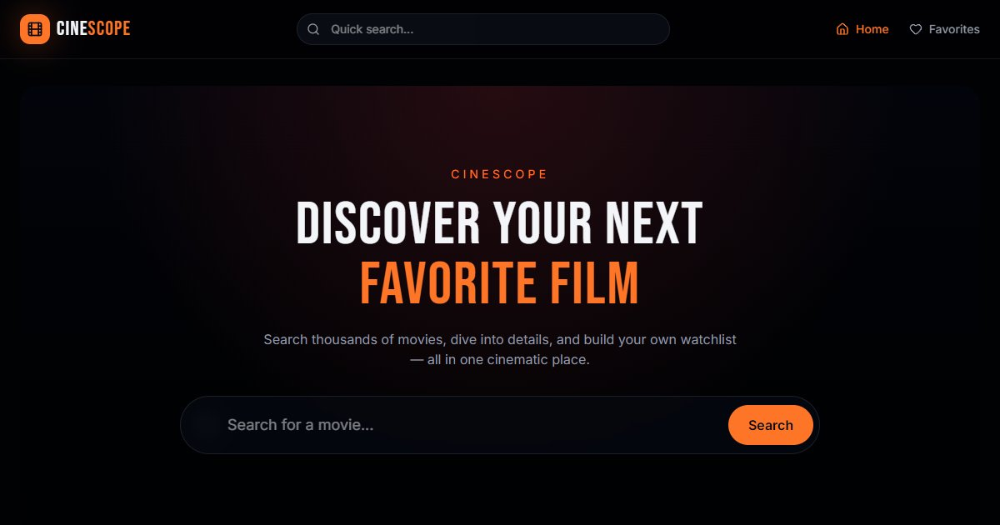

# CineScope

[](https://github.com/ramezGamel01/CINESCOPE/actions/workflows/ci.yml)

A movie discovery app: browse this week's trending films, search any title, open a movie for its cast and trailer, and keep a list of favorites.

**Live:** https://cinescope-gamma-ruby.vercel.app



## Features

- Trending movies of the week on the home page
- Search with a debounced input; results have their own shareable URL (`/search/<query>`)
- Movie pages with rating, runtime, genres, cast and the official trailer
- Favorites saved in the browser, no account needed
- Loading skeletons, empty states and clear error messages
- Responsive layout with a dark, cinema-style design

## Stack

React 19, TanStack Start (file-based routing and server rendering), TanStack Query, TypeScript, Tailwind CSS v4 and shadcn/ui components. Data from The Movie Database (TMDB) API. Deployed on Vercel.

## Run locally

Requires Node.js 22 or newer and a free TMDB API key from [themoviedb.org](https://www.themoviedb.org/settings/api).

```bash
npm install
cp .env.example .env    # then put your key in VITE_TMDB_API_KEY
npm run dev             # http://localhost:8080
```

## Project structure

```
src/routes/           pages: home, search, movie details, favorites
src/components/       movie grid and cards, details view, search bar, states
src/services/tmdb.ts  TMDB API client
src/hooks/            favorites storage, debounce
```

## Credits

Movie data and images are provided by [TMDB](https://www.themoviedb.org). This product uses the TMDB API but is not endorsed or certified by TMDB.
